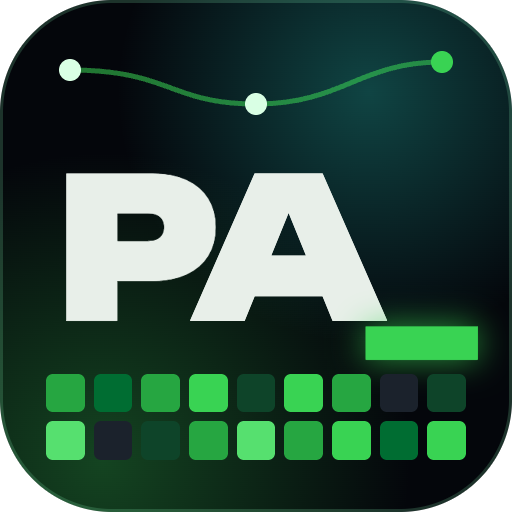
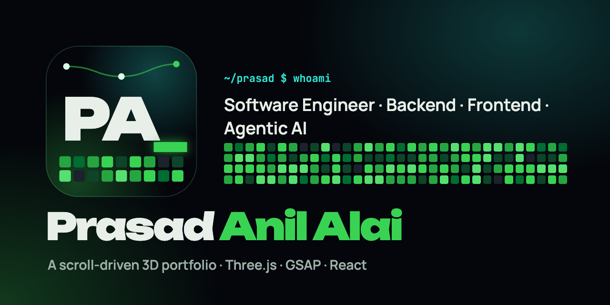

<p align="center"></p>

<h1 align="center">Prasad Anil Alai · Portfolio</h1>

<p align="center"></p>

A scroll-driven 3D story, told as a `git log`. The camera rides a glowing commit line through space, and every chapter is a commit with its own set-piece:

| # | Chapter | Scene |
|---|---|---|
| 00 | `init: hello, world` | The pitch: Software Engineer across Backend · Frontend · Agentic AI, with production impact numbers. A particle core (a dandelion clock by day) with the three pillars in orbit |
| 01 | `release: in production @ FlexiLoans` | Five systems on a panorama, each a small working machine. The Customer Journey Portal gets three stops: its onboarding and post-sanction journey as a track of gates (with the partner each step calls lighting up) and the customer dashboard floating above it. Then the Agent Workbench (a no-code builder deploying an agent that calls tools through Flexi-MCP), Flexy's multilingual voice orb filling an application and routing the lead, the statement parser, and the credit-score engine |
| 02 | `merge: things I built on my own` | Kosha (a kirana's ledger flying into a credit passport), VANA (a lotus breathing on a pond), Transcribo (a meeting whose speakers are written into the minutes) |
| 03 | `perf: code, every single day` | **Daily activity in 3D**: the last 12 months of GitHub (both accounts) + LeetCode, as a glowing field at night or a meadow on a floating island by day; hover a day for the split. Then LeetCode: the difficulty ring wrapped in a helix of the last 365 days |
| 04 | `feat: B.E. Information Technology` | Education, leadership and certifications around an orbiting crystal |
| 05 | `chore: toolchain` | A draggable constellation of every tool |
| 06 | `push: origin/future` | Warp (or wind) into a portal, then the contact details |

**Day and night.** The sun/moon button (or `theme day` in the terminal) switches between the night-shift theme and a daylight theme painted after Studio Ghibli backgrounds: a summer sky with painted cumulus and a sea of cloud below, toon-shaded scenes, floating islands, wind lines and drifting leaves, storybook type (Fraunces) on cream paper. The switch opens as a circle from the button (View Transitions API). The first visit follows the system setting; `?theme=light|dark` forces one.

Press <kbd>`</kbd> (or <kbd>⌘K</kbd>) for a terminal: `help`, `whoami`, `projects`, `open kosha`, `goto grind`, `sudo hire-me`.

## Stack

Vite 8 · React 19 · TypeScript · Three.js r186 (vanilla, with UnrealBloom) · GSAP 3.15 (ScrollTrigger, SplitText) · Lenis.

## Run

```bash
npm install
npm run dev            # http://localhost:5173
npm run build          # refreshes the contribution snapshot, typechecks, builds to dist/
npm run preview
```

## Where things live

| Path | What |
|---|---|
| `src/data/profile.ts` | **Every word on the site.** Edit this to change content |
| `src/data/activity.json` | Build-time snapshot of GitHub (both accounts) + LeetCode (`npm run activity`; `npm run build` refreshes it) |
| `src/lib/activity.ts` | Merges the sources, refreshes GitHub live in the browser, streaks, calendar grid |
| `src/lib/theme.ts`, `src/webgl/paint.ts` | Theme state, and the theme-aware toon materials and labels every scene is built from |
| `src/styles/daylight.css` | The daylight theme for the page |
| `src/webgl/World.ts` | Renderer, bloom, the scroll-driven camera rig, culling, hover/drag |
| `src/webgl/pieces/*` | One file per set-piece (`Flexi.ts` holds the five production scenes; `Sky.ts` the daylight sky, clouds and wind) |
| `src/components/Sections.tsx` | The story's DOM, one `data-stop` per camera stop |
| `src/components/Chrome.tsx` | Loader, HUD + progress rail, cursor, tooltip, terminal |
| `src/lib/motion.ts` | GSAP reveals, split text, count-ups, scramble, magnetic buttons |

**About the activity data:** every number is real. LeetCode's API refuses browser requests, so its half comes from the snapshot taken at build time; GitHub refreshes live. Contributions to private repositories only appear if "Include private contributions" is on in GitHub's profile settings.

**How the camera works:** each element with `data-stop` has a camera pose in `World.ts` (`keys`). The page's scroll position becomes a continuous "story" value between stops; the camera holds while a stop's text is centred, then flies to the next. Poses fit the subject to the screen, so they adapt to any aspect ratio, with separate framing for phones.

**Performance:** a device tier (after Kosha's `perf.ts`) picks particle counts, pixel ratio and bloom. A frame guard drops to the low tier if the frame rate stays under ~28 fps. `?perf=low` or `?perf=high` forces a tier. Far-away set-pieces are culled. Reduced-motion users get no smooth scroll, no intro flight and no reveals.

## Deploy

Vercel: import the folder; `vercel.json` sets the build. Any static host works: upload `dist/`.
